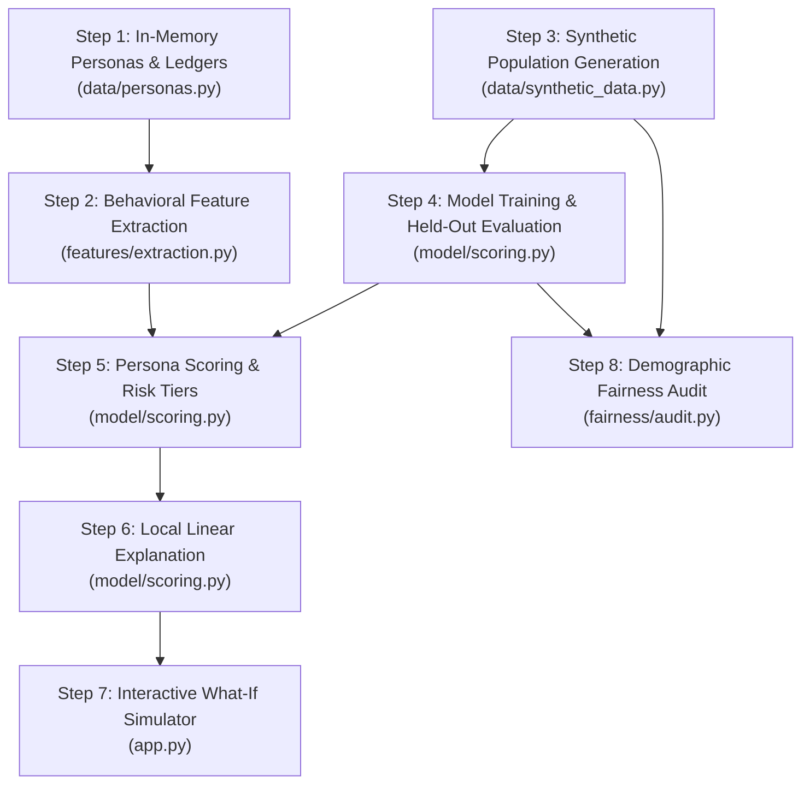

# AltScore AI: Backend Architecture & Workflow Guide

Welcome to the backend architecture guide for **AltScore AI**. This document explains in simple, plain English how the entire backend functions from start to finish, the exact sequence in which code runs, what technology is used at each step, and why that technology was chosen.

---

## 1. Quick Summary of Technologies Used

| Technology | What it is | Where it is used | Why we chose it |
| :--- | :--- | :--- | :--- |
| **Python (3.10+)** | Core programming language | Entire backend & application | Easy to read, vast ecosystem for data science and machine learning. |
| **Pandas** | Data table library | Data loading, transformation, summary tables | Fast in-memory data frames, structured manipulation, and seamless export to UI. |
| **NumPy** | Math & statistics library | Standard deviation, mean, capping, array math | Lightning-fast numeric computations for calculating cash-flow consistency. |
| **Scikit-Learn** | Machine learning library | Logistic regression, train/test split, metrics | Industry standard, lightweight, produces exact mathematical probabilities. |
| **Streamlit** | Interactive web application framework | User interface and live reactive recalculations | Python-native, automatically reruns logic when sliders change without complex JavaScript. |

---

## 2. End-to-End Execution Sequence (Step-by-Step)

When a user opens AltScore AI or interacts with it, the backend executes in this exact sequential order:



---

### Step 1: Generating Personas and Cash-Flow Ledgers
* **File:** [`data/personas.py`](file:///d:/credit%20project/data/personas.py)
* **Technology Used:** Pure Python dictionaries & lists.
* **What happens:**
  - We create three realistic synthetic profiles: **Ramesh Kumar** (rural grocery store owner), **Sunita Devi** (urban tailor/artisan), and **Aarav Sharma** (urban gig delivery courier).
  - Each persona receives a 6-month simulated transaction ledger containing dates, descriptions, categories (e.g., utility bills, income, inventory), amounts, and payment statuses (e.g., `completed`, `paid_on_time`, `late`).
* **Why this way:**
  - Keeping everything in memory eliminates external database setups (like PostgreSQL or MongoDB), prevents privacy risks, and guarantees 100% reproducibility for hackathon judges.

---

### Step 2: Extracting Financial Behavioral Features
* **File:** [`features/extraction.py`](file:///d:/credit%20project/features/extraction.py)
* **Technology Used:** Python, NumPy, Pandas.
* **What happens:**
  - The raw transaction history is analyzed to extract **four behavioral indices**:
    1. **Income Stability (0.0 to 1.0):** Measures monthly income volatility ($1 - \sigma / \mu$). Steady income scores near 1.0.
    2. **Bill-Payment Consistency (0.0 to 1.0):** Percentage of utility/rent bills paid on time. If no bills exist, defaults to 1.0 (missing bills do not count as missed payments).
    3. **Payment Regularity (0.0 to 1.0):** Ratio of observed months with active incoming cash flow.
    4. **Financial Liquidity Buffer (0.0 to 6.0 months):** How many months the borrower can survive on liquid savings ($\text{Balance} / \text{Average Monthly Outflows}$). Strictly capped at 6 months to prevent extreme wealth outliers.
* **Why this way:**
  - Demographics (gender, age, location) are strictly left out of these features to prevent direct discrimination.

---

### Step 3: Generating the Synthetic Training Population
* **File:** [`data/synthetic_data.py`](file:///d:/credit%20project/data/synthetic_data.py)
* **Technology Used:** NumPy (random distributions), Pandas (DataFrames).
* **What happens:**
  - We generate $N=1,000$ synthetic borrower records using a fixed random seed (`seed=42`).
  - A simulated repayment outcome ($0$ or $1$) is assigned based on a realistic logistic formula:
    $$\text{logit} = -3.2 + 1.8(\text{Income Stability}) + 2.6(\text{Bill Consistency}) + 1.5(\text{Payment Regularity}) + 1.5\left(\frac{\text{Liquidity Buffer}}{6}\right) + \epsilon$$
  - A random noise term ($\epsilon \sim \mathcal{N}(0, 0.6)$) represents unpredictable real-world life shocks (medical emergencies, unexpected costs).
* **Why this way:**
  - The noise prevents the target from being artificially trivial, making the machine learning task realistic and credible.

---

### Step 4: Training the Baseline Model & Held-Out Evaluation
* **File:** [`model/scoring.py`](file:///d:/credit%20project/model/scoring.py)
* **Technology Used:** Scikit-Learn (`LogisticRegression`, `train_test_split`, `roc_auc_score`, `precision_score`, etc.).
* **What happens:**
  - The $1,000$ records are split into **750 training records (75%)** and **250 held-out test records (25%)**.
  - A Logistic Regression model is fitted **exclusively on the 4 behavioral features**.
  - We compute performance metrics strictly on the unseen test split: ROC-AUC ($0.583$), Accuracy ($80.0\%$), Precision ($80.8\%$), and Recall ($98.5\%$).
* **Why Logistic Regression?**
  - Unlike "black-box" deep neural networks or complex ensembles, Logistic Regression produces:
    1. Exact probabilistic outputs ($0.0$ to $1.0$).
    2. Linear weights ($\beta$) that can be directly explained to borrowers and regulators.
    3. Blazing fast training (< 15 milliseconds).

---

### Step 5: Persona Scoring & Risk Classification
* **File:** [`model/scoring.py`](file:///d:/credit%20project/model/scoring.py)
* **Technology Used:** Pure Python math & Scikit-Learn `.predict_proba()`.
* **What happens:**
  - The selected persona's 4 features are passed into the fitted model to calculate repayment probability $P$.
  - **Illustrative Score:** Mapped to an intuitive 300–900 scale:
    $$\text{Score} = \text{round}(300 + 600 \times P)$$
  - **Risk Categorization:**
    - **Low Risk:** Probability $\ge 85\%$ (Score 810–900)
    - **Medium Risk:** Probability $70\% - 85\%$ (Score 720–809)
    - **High Risk:** Probability $< 70\%$ (Score 300–719)
* **Why this way:**
  - Gives borrowers a familiar credit score range while clearly disclaiming that this is an illustrative transformation, not an established bureau score like CIBIL or FICO.

---

### Step 6: Local Linear Explainability
* **File:** [`model/scoring.py`](file:///d:/credit%20project/model/scoring.py) (`explain_prediction`)
* **Technology Used:** Linear algebra decomposition.
* **What happens:**
  - We explain **why** the model produced this specific score by decomposing the log-odds equation:
    $$\text{Total Logit} = \beta_0 + (\beta_1 \cdot x_1) + (\beta_2 \cdot x_2) + (\beta_3 \cdot x_3) + (\beta_4 \cdot x_4)$$
  - Each feature's local contribution is its observed value multiplied by its learned weight ($\beta_i \cdot x_i$).
  - Positive contributions increase the odds of loan approval; negative contributions lower it.
* **Why this way:**
  - Total transparency. A loan officer or applicant can see the exact numerical reason behind the decision.

---

### Step 7: Interactive What-If Scenario Exploration
* **File:** [`app.py`](file:///d:/credit%20project/app.py) (`render_what_if_simulator`)
* **Technology Used:** Streamlit interactive sliders & state.
* **What happens:**
  - The user can adjust any of the 4 sliders (e.g., increasing savings or paying bills on time).
  - The modified numbers pass through the **exact same model pipeline**, instantly recalculating probability, score, risk category, and explanations side-by-side with the baseline.
* **Why this way:**
  - Empowers financial counseling: instead of a simple "denied" stamp, the applicant sees: *"If you increase your savings reserve from 0.8 months to 2.5 months, your score increases by +68 points into Medium Risk."*

---

### Step 8: Demographic Fairness & Disparate Impact Audit
* **File:** [`fairness/audit.py`](file:///d:/credit%20project/fairness/audit.py)
* **Technology Used:** Pandas grouping and statistical auditing rules.
* **What happens:**
  - All $1,000$ synthetic borrowers are evaluated using a documented approval threshold ($P \ge 0.70$).
  - We calculate approval rates across protected groups:
    - **Gender:** Female approval rate vs. Male approval rate.
    - **Geography:** Rural approval rate vs. Urban approval rate.
  - Computes the **Disparate Impact Ratio**:
    $$\text{Disparate Impact Ratio} = \frac{\text{Approval Rate of Lower Group}}{\text{Approval Rate of Higher Group}}$$
  - Checks if the ratio passes the legal **Four-Fifths Rule ($\ge 0.80$)**.
* **Why the Proxy Bias Warning is Critical:**
  - Even though gender and location are omitted from model features, financial features can still correlate with historical societal inequities (e.g., unequal access to banking). Our audit explicitly highlights this governance nuance.

---

## 3. Directory & File Reference

```
credit-score/
│
├── app.py                 # Streamlit UI dashboard connecting all components
├── requirements.txt       # Dependencies list
├── PLAN.md                # 10-slice build plan and progress log
├── README.md              # Project overview, formulations & judge demo script
├── BACKEND.md             # This backend architecture document
│
├── data/
│   ├── personas.py        # 3 personas (Ramesh, Sunita, Aarav) & 6-month transaction histories
│   └── synthetic_data.py  # 1,000 reproducible training rows with latent logistic target
│
├── features/
│   └── extraction.py      # Feature extraction engine (4 financial metrics + missing data rules)
│
├── model/
│   └── scoring.py         # Logistic regression, 75/25 split, scoring formula, linear explanations
│
└── fairness/
    └── audit.py           # Approval rates, disparate impact ratio, 4/5ths rule, zero-rate handling
```

